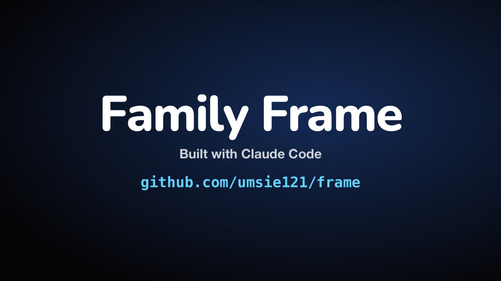

# Family Frame

[](https://umsie121.github.io/frame/)

[Watch the film](https://umsie121.github.io/frame/). Everything shown in it is mock data.

A calm, photo-first family display that runs entirely on a Frameo **K1003** photo frame (Rockchip RK3126, 1 GB RAM,
Android 6, a 2015-era Chromium 44 WebView). No server. Mostly your photos, with Apple-style glass widgets for the time,
weather, next prayer, next event and 3D-printer status. Tap for calendar, prayer times, Spotify Connect with live lyrics
and a visualiser, full printer status and more.

A small dependency-free Java app stores media, accepts uploads and bridges to the printer. All features live in a
TypeScript web UI that deploys over Wi-Fi in seconds. Built with Claude Code; `CLAUDE.md` holds the working notes,
including the hardware limits everything is designed around. Published as a one-off copy of a private working repo:
personal data and device-specific notes are removed.

## Sending photos
- **QR code**: on the frame, tap → Photos → scan with a phone on the home Wi-Fi.
- **iOS Shortcut**: "Send to Frame" in the Share Sheet — see [docs/SHORTCUT.md](docs/SHORTCUT.md).
- iPhones: photos must arrive as JPEG and videos as H.264 (Settings → Camera → Formats → Most Compatible,
  or let the Shortcut convert).

## Developing
```bash
pnpm install
pnpm dev             # desktop preview at http://localhost:5173 using the real frame's photos (needs .env)
pnpm deploy:frame    # ship UI changes to the frame over Wi-Fi; it reloads itself
```
`.env` (git-ignored) needs `FRAME_URL` and `FRAME_ADMIN_TOKEN` — see `.env.example`.

Native changes (rare): `android/build.sh && adb install -r android/build/family-frame-shell.apk`.
Toolchain (no sudo): `brew install openjdk@17 && brew install --cask android-commandlinetools`, then
`sdkmanager --sdk_root=/opt/homebrew/share/android-commandlinetools "build-tools;34.0.0" "platforms;android-34"`.

## Backups and undo
- Photo library: `adb pull /sdcard/FamilyFrame ./frame-library-backup`
- Back to Frameo: press the frame's Back key. Remove our app: `adb uninstall com.familyframe.shell` (photos stay).

## Docs
[CLAUDE.md](CLAUDE.md) · [docs/ARCHITECTURE.md](docs/ARCHITECTURE.md)

